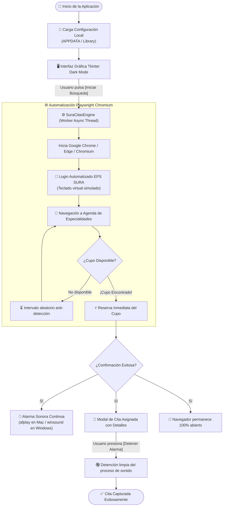

<div align="center">

# ⚡ SURA Citas Bot — Enterprise Cross-Platform Edition
### Solución Automatizada de Monitoreo, Caza y Confirmación de Citas Médicas en EPS SURA

[](https://github.com/ShionBanned/sura-citas-bot)
[](https://www.python.org/)
[](https://playwright.dev/)
[](https://github.com/ShionBanned/sura-citas-bot)
[](https://opensource.org/licenses/MIT)
[](https://github.com/ShionBanned)

<br/>

**SURA Citas Bot** es una aplicación de escritorio de alto rendimiento diseñada para vigilar, detectar y reservar turnos médicos en el portal oficial de **EPS SURA**. Opera de forma ininterrumpida y desatendida, reaccionando en milisegundos ante cancelaciones y liberaciones de cupos.

[Descargar Última Versión](#-descarga-e-instalación-rápida) • [Características](#-características-y-comparativa-multiplataforma) • [Arquitectura](#-diagrama-de-arquitectura-del-sistema) • [Privacidad](#-compromiso-de-privacidad-100-local)

</div>

---

## 🌟 Aspectos Destacados

- 🎯 **Monitoreo Continuo Inteligente:** Inspección periódica de agendas con intervalos no detectables y emulación de interacción humana.
- 🚨 **Alarma Acústica Continua:** Sirena de emergencia de alta penetración acústica que suena en bucle continuo e ininterrumpido hasta ser silenciada de forma manual por el usuario.
- 🖥️ **Ventana de Confirmación Visible:** Al completarse la cita, el navegador web permanece 100% abierto en primer plano para que el usuario verifique la reserva o gestione instrucciones médicas.
- 🔒 **Seguridad y Privacidad Estricta:** Cero telemetría, sin recolección de métricas. Tus credenciales se almacenan única y exclusivamente en tu propio equipo local.
- 🌐 **Nativo Multiplataforma:** Diseñado con interfaces y subcomponentes nativos tanto para **Microsoft Windows** como para **Apple macOS**.

---

## 📊 Características y Comparativa Multiplataforma

| Componente / Módulo | 🪟 Windows Edition (10 / 11) | 🍎 macOS Edition (12+ / Apple Silicon & Intel) |
| :--- | :--- | :--- |
| **Instalador Oficial** | `Instalador_SuraCitas_Setup.exe` (Inno Setup 1-clic) | `Instalador_SuraCitas.dmg` (Drag-and-Drop a `/Applications`) |
| **Ejecución Directa** | `build_windows.bat` o `python main.py` | `run_macos.command` (Lanzador 1-clic con auto-venv) |
| **Sistema Acústico** | Win32 Multimedia API (`winsound.PlaySound` Loop) | CoreAudio CLI nativo (`afplay` asíncrono con control PID) |
| **Ruta de Configuración**| `%APPDATA%\SuraCitasApp\settings.json` | `~/Library/Application Support/SuraCitasApp/settings.json` |
| **Tipografía UI** | `Segoe UI` & `Consolas` | `Helvetica Neue` & `Menlo` |
| **Detección Navegador** | Google Chrome y Microsoft Edge | Google Chrome, Edge, Brave y Chromium |
| **Seguridad del Proceso**| Detección de depuración en Kernel32 | Verificación pasiva segura con sandboxing local |

---

## 🏗️ Diagrama de Arquitectura del Sistema

El siguiente diagrama ilustra el flujo operativo integral desde la autenticación hasta la reserva confirmada y la activación de alarmas:



---

## 📦 Descarga e Instalación Rápida

### 🪟 Para Usuarios de Windows (10 y 11)

1. Descarga el instalador más reciente: **`Instalador_SuraCitas_Setup.exe`** desde la sección de [Releases](https://github.com/ShionBanned/sura-citas-bot/releases).
2. Ejecuta el instalador. No requiere permisos de administrador (`PrivilegesRequired=lowest`).
3. Se creará automáticamente un acceso directo en tu Escritorio y en el Menú Inicio.
4. Abre la aplicación, ingresa tu número de cédula y tu contraseña de 4 dígitos, selecciona los filtros deseados y presiona **`[ ▶ INICIAR BÚSQUEDA ]`**.

---

### 🍎 Para Usuarios de macOS (Apple Silicon M1/M2/M3/M4 & Intel)

#### Opción A: Instalador `.dmg` (Recomendado)
1. Descarga **`Instalador_SuraCitas.dmg`** desde [Releases](https://github.com/ShionBanned/sura-citas-bot/releases).
2. Haz doble clic para abrir la imagen de disco.
3. Arrastra el icono de **SuraCitas** a la carpeta **Applications**:
   ```text
   ┌──────────────────────────────────────────────┐
   │              Sura Citas Bot                  │
   │                                              │
   │    [ SuraCitas.app ]   ════▶   [ Applications ] │
   │                                              │
   └──────────────────────────────────────────────┘
   ```
4. Expulsa el `.dmg`.

#### 🛡️ Autorizar Gatekeeper en macOS (Desarrollador no verificado)
Dado que la aplicación se distribuye de manera libre y abierta fuera del Mac App Store comercial:
- **Vía Gráfica:** Ve a `Aplicaciones`, mantén presionada la tecla `Control` (Ctrl), haz **clic derecho** sobre `SuraCitas.app` y pulsa **Abrir**.
- **Vía Terminal (Inmediata):**
  ```bash
  xattr -cr /Applications/SuraCitas.app
  ```

#### Opción B: Lanzador 1-Clic (`run_macos.command`)
Si descargas el código fuente:
1. Haz doble clic en el archivo **`run_macos.command`**.
2. El script configurará automáticamente el entorno virtual (`.venv`), instalará las librerías necesarias y abrirá la aplicación directamente.

---

## 🛠️ Compilación y Empaquetado desde el Código Fuente

### Clonar el Repositorio
```bash
git clone https://github.com/ShionBanned/sura-citas-bot.git
cd sura-citas-bot
```

### 🪟 Compilar en Windows
Ejecuta el script automatizado:
```cmd
build_windows.bat
```
Generará:
- `dist\SuraCitas.exe` (Binario independiente)
- `dist\Instalador_SuraCitas_Setup.exe` (Instalador Inno Setup)

### 🍎 Compilar en macOS
```bash
chmod +x build_mac.sh packaging/macos/build_dmg.sh
./build_mac.sh
```
Generará:
- `dist/SuraCitas.app` (macOS Application Bundle)
- `dist/Instalador_SuraCitas.dmg` (Imagen de disco lista para distribución)

---

## 🔒 Compromiso de Privacidad 100% Local

> [!IMPORTANT]
> **Tu privacidad y seguridad son prioritarias:**
> - **Cero Servidores Intermedios:** El bot se comunica única y exclusivamente con los endpoints oficiales de EPS SURA (`login.sura.com` y `portaleps.epssura.com`).
> - **Almacenamiento Local Aislado:** Tu cédula y clave se guardan únicamente si activas voluntariamente la casilla *«Recordar mis datos»*, residiendo exclusivamente en el almacenamiento seguro de tu usuario local (`%APPDATA%` o `~/Library/Application Support`).
> - **Sin Rastreo ni Telemetría:** No recopilamos analíticas, correos, IPs ni patrones de uso.

---

## 📜 Licencia y Reconocimientos

Distribuido bajo la Licencia **MIT**. Consulta el archivo [`LICENSE`](LICENSE) para mayores detalles.

Desarrollado y firmado por **[Shion](https://github.com/ShionBanned)** — Arquitectura Multiplataforma Empresarial.
